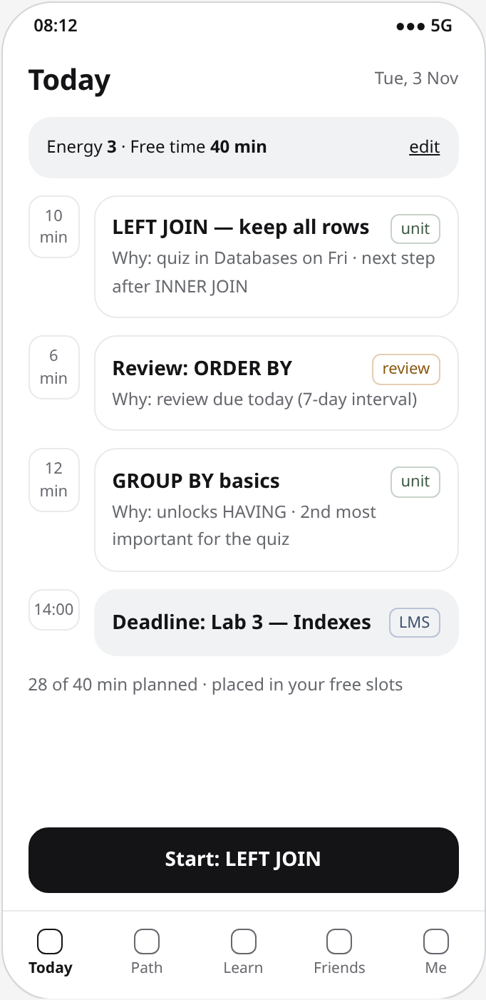
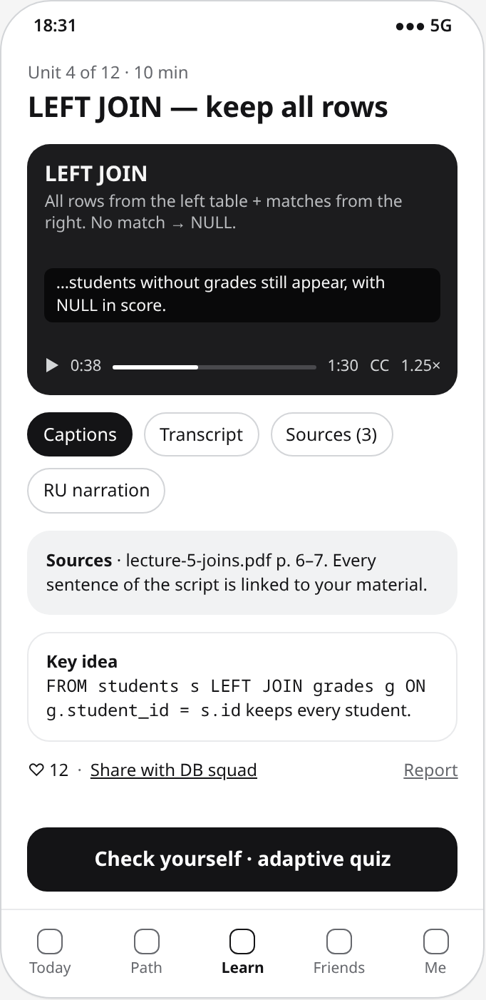
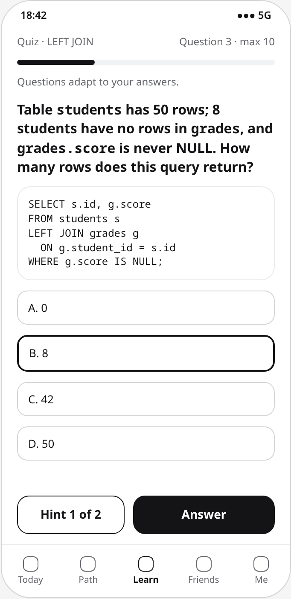
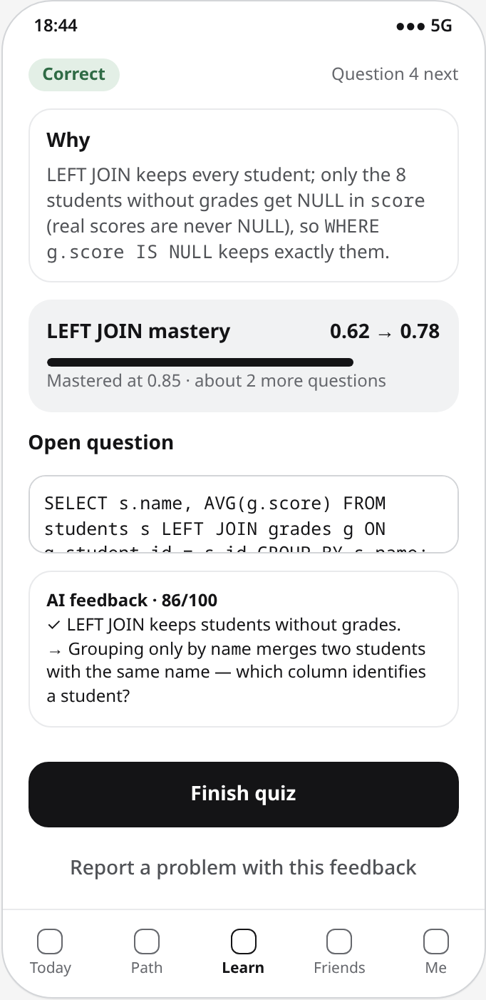

<div align="center">

<picture><source media="(prefers-color-scheme: dark)" srcset="docs/assets/aitu-logo-white.svg"></picture>&nbsp;&nbsp;&nbsp;&nbsp;&nbsp;&nbsp;

# YeahGrind

**An intelligent social learning platform with personalized microlearning pathways,<br>short-form video generation and adaptive knowledge assessment**

<sub>Diploma project · Software Engineering · Astana IT University · group SE-2425 · 2026–2027</sub>

<br>

[](docs/submission/pre-defense-1.md)
[](#-current-status)
[](https://yeahgrind.youtrack.cloud/projects/YG)


[**📄 Pre-defense document**](docs/PreDefense_YeahGrind.docx) · [**📋 YouTrack board**](https://yeahgrind.youtrack.cloud/agiles/204-1) · [**🧩 Prototype**](prototype/index.html) · [**📐 Diagrams**](diagrams/) · [**🔌 API**](api/openapi.yaml)

</div>

---

## ✨ The idea

YeahGrind turns a learning goal or a university subject, optionally with the student's own lecture notes, into a personal path of **micro-units**. Each unit fits the time the student has today, is explained by a **short generated video**, and is checked with an **adaptive quiz** that updates mastery per skill. Students learn together with friends and study groups through shared progress and cooperative goals.

<p align="center"><b>🎯 Goal or subject &nbsp;→&nbsp; 🗺️ Skill map &nbsp;→&nbsp; 📅 Today's micro-plan &nbsp;→&nbsp; 🎬 Micro-unit + video &nbsp;→&nbsp; 🧠 Adaptive quiz &nbsp;→&nbsp; 📈 Mastery &nbsp;→&nbsp; 👥 Study group</b><br>
<sub>Mastery feeds the next day's plan: weak skills come back as units, mastered ones as spaced reviews.</sub></p>

<table>
<tr>
<td width="25%" valign="top">

### 🗺️ Pathway
Prerequisite-gated, explainable scoring: knowledge gap, goal weight, due review and deadline. Every recommended unit shows why it was chosen.

</td>
<td width="25%" valign="top">

### 🎬 Short video
A grounded script checked sentence by sentence against the unit, narrated by TTS and drawn as 9:16 slides with captions, a transcript and sources.

</td>
<td width="25%" valign="top">

### 🧠 Assessment
Elo-style ability per skill and difficulty per question, the next question near 70 % expected success, and a stopping rule after the skill is classified.

</td>
<td width="25%" valign="top">

### 👥 Social learning
Friends, a feed with private scores, sharing and study groups with cooperative weekly goals instead of punitive leagues.

</td>
</tr>
</table>

## 🎯 Problem, users and expected outcomes

**Problem.** Students study independently, mostly in focused sessions shortly before deadlines, choosing what to study by the nearest deadline, while their materials are long and follow one fixed order. Explanations in a convenient format are missing, and gaps in knowledge show up only at the exam. Social features in learning apps are mostly competitive. The existing systems analyzed cover only parts of this ([comparison](docs/04-existing-systems-comparison.md)).

**Target users.** AITU undergraduate students (18+) who study on their own or in small groups. Secondary users: study-group members and a content moderator.

**Expected outcomes.**
1. A deployed PWA with the cycle *goal → personalized pathway → micro-unit with short video → adaptive quiz → mastery update → next step → share with friends*.
2. Explainable pathway and assessment engines (Elo-style ability per skill and item difficulty, adaptive item selection).
3. An asynchronous, validated video generation pipeline.
4. An evaluation against a non-adaptive baseline: component benchmarks plus a pilot learning and usability study with a one-week retention test.

Details: [project proposal](docs/01-project-proposal.md).

## 🧩 Prototype

<div align="center">
<table>
<tr>
<td align="center"><br><sub><b>Today's micro-plan</b><br>every unit has a reason</sub></td>
<td align="center"><br><sub><b>Micro-unit and video</b><br>captions, transcript, sources</sub></td>
<td align="center"><br><sub><b>Adaptive quiz</b><br>hints before the answer</sub></td>
<td align="center"><br><sub><b>Feedback and mastery</b><br>why right or wrong</sub></td>
</tr>
</table>

<sub>11 clickable screens in <a href="prototype/index.html"><code>prototype/index.html</code></a> · scenarios and requirements in <a href="docs/08-ux-prototype.md">UX and prototype</a></sub>
</div>

## 🏗️ Architecture

A modular monolith on Next.js with background jobs in the web process, three engines (pathway, assessment, video) and an AI gateway with provider adapters. All diagrams are in [`diagrams/`](diagrams/) as editable PlantUML sources with SVG/PNG exports; the description is in [architecture and diagrams](docs/07-architecture.md).

<div align="center">

<br><sub>Component diagram · more: <a href="diagrams/export/01-system-context.svg">context</a> · <a href="diagrams/export/02-use-case.svg">use cases</a> · <a href="diagrams/export/04-data-model.svg">data model</a> · <a href="diagrams/export/05-sequence-trajectory-quiz.svg">pathway and quiz</a> · <a href="diagrams/export/06-sequence-video-generation.svg">video generation</a> · <a href="diagrams/export/07-deployment.svg">deployment</a></sub>
</div>

## 🛠️ Selected technologies

Comparison and scoring: [technology comparison](docs/05-technology-comparison.md) (13 decisions, weighted criteria) · decisions: [ADRs](docs/adr/)

| Layer | Choice |
|---|---|
| Application | Next.js 16 + React + TypeScript (strict), modular monolith; background jobs in the web process |
| Data | PostgreSQL 18, Prisma ORM 7 (upgraded from 6 in sprint S1); jobs as PostgreSQL rows with a claim; schedules from GitHub Actions |
| API | REST + OpenAPI ([`api/openapi.yaml`](api/openapi.yaml)), Zod validation |
| Authentication | Auth.js v5 (e-mail + password, Microsoft Entra ID restricted to the university tenant); Better Auth as migration target |
| AI | LLM via a provider adapter (OpenAI primary, Anthropic fallback); Gemini TTS for narration behind an adapter (Azure AI Speech as the target) |
| Video | LLM script → grounding check → one narration track → slides drawn on a canvas in the browser, recorded to MP4/WebM on request, WebVTT captions |
| Assessment | Elo-style rating per learner–skill and per item; next item near 70 % expected success |
| Media | Narration audio in PostgreSQL (release 1); S3-compatible object storage as media grow |
| Hosting | Railway (web service, PostgreSQL); GitHub Actions CI and scheduled workflows |
| Testing | Vitest, fast-check, Playwright, axe-core, k6, Lighthouse CI |

## 🔭 Scope

<table>
<tr>
<td width="60%" valign="top">

**In scope**
- responsive web app / PWA; e-mail and Microsoft Entra ID sign-in
- goals and subjects, with own material (text, PDF)
- skill maps and micro-units
- a personalized pathway with daily check-in, Moodle deadlines and spaced review
- 60–120 s generated videos with narration and captions (EN, RU; KK after a quality check)
- adaptive assessment with placement test, mastery reports and AI feedback on open answers
- friends, feed, sharing, study groups with cooperative goals, moderation
- non-punitive gamification; privacy controls
- interface in English, Russian and Kazakh

</td>
<td width="40%" valign="top">

**Out of scope**
- native apps
- model training, deep knowledge tracing
- photorealistic avatar video
- reading Moodle course content or grades
- official grading or proctoring
- payments

</td>
</tr>
</table>

## 👥 Team

<table>
<tr>
<td align="center" width="50%" valign="top">
<a href="https://github.com/Yera0008"><br><b>Yernar Katyshev</b></a><br><sub>@Yera0008 · Backend and business logic</sub><br><br>
<sub>Data model, API, content generation, pathway engine, adaptive assessment, video pipeline, AI gateway, LMS integration, CI/CD</sub>
</td>
<td align="center" width="50%" valign="top">
<a href="https://github.com/ayatyeah"><br><b>Ayat Balmagambet</b></a><br><sub>@ayatyeah · Frontend and UX</sub><br><br>
<sub>PWA, user research, prototype, learning, video and quiz interfaces, social features, accessibility, localization (EN/RU/KK)</sub>
</td>
</tr>
</table>

**Supervisor:** Arstan Makatov — review of deliverables at agreed checkpoints.
Both members co-own requirements, verification and project management; the full allocation is in [project management](docs/10-project-management-risks.md#102-responsibilities).

## 🔗 Links

| | |
|---|---|
| 📋 YouTrack | [Project YG](https://yeahgrind.youtrack.cloud/projects/YG) — 56 assigned and prioritized tasks with dependency links · [Scrum board](https://yeahgrind.youtrack.cloud/agiles/204-1) with sprints PD1 and S1–S13 · import source: [`project-management/youtrack-backlog.csv`](project-management/youtrack-backlog.csv) |
| 📚 Documentation | [`docs/`](docs/) — index below |
| 📐 Diagrams | [`diagrams/`](diagrams/) (editable PlantUML + SVG/PNG) |
| 🧩 Prototype | [`prototype/index.html`](prototype/index.html) (clickable mockups), [screens](prototype/screens/) |
| 🔌 API contract | [`api/openapi.yaml`](api/openapi.yaml), [examples](api/examples/) |
| 📨 Pre-defense 1 submission | [`docs/submission/pre-defense-1.md`](docs/submission/pre-defense-1.md) |
| 📄 Pre-defense 1 document (Word) | [`docs/PreDefense_YeahGrind.docx`](docs/PreDefense_YeahGrind.docx) |

### 📚 Documentation index

| # | Document | # | Document |
|---|---|---|---|
| 1 | [Project proposal](docs/01-project-proposal.md) | 7 | [Architecture and diagrams](docs/07-architecture.md) |
| 2 | [Evidence of relevance](docs/02-evidence-of-relevance.md) · [interview kit](docs/research/) | 8 | [UX and prototype](docs/08-ux-prototype.md) |
| 3 | [Literature review](docs/03-literature-review.md) | 9 | [Verification and evaluation plan](docs/09-verification-evaluation-plan.md) |
| 4 | [Existing system comparison](docs/04-existing-systems-comparison.md) | 10 | [Project management and risks](docs/10-project-management-risks.md) |
| 5 | [Technology comparison](docs/05-technology-comparison.md) · [ADRs](docs/adr/) | 11 | [Supervisor feedback](docs/11-supervisor-feedback.md) |
| 6 | [Requirements specification](docs/06-requirements-specification.md) | | |

## 🗂️ Repository layout

```
docs/                 proposal, evidence, literature, comparisons, requirements, architecture, UX, verification, management
  research/           interview guide, consent and recruitment, note template
  adr/                architecture decision records
  submission/         pre-defense summaries and talk outline
  assets/             logos used in this README
diagrams/src          editable PlantUML sources         diagrams/export   SVG and PNG exports
prototype/            clickable HTML mockups + PNG       api/              OpenAPI contract + examples
src/                  application code by component (see src/README.md)
tests/                acceptance scenarios, test plan structure (see tests/README.md)
config/               .env.example with placeholders
project-management/   YouTrack backlog import
.github/              pull request template, issue template, CODEOWNERS
```

## 📍 Current status

| Area | Status |
|---|---|
| Analysis and design (proposal, evidence, literature, comparisons, requirements, architecture, prototype, verification plan, plan and risks) | ✅ Submitted for pre-defense 1 (24 October 2026), tag [`pre-defense-1`](https://github.com/ayatyeah/yeahgrind/tree/pre-defense-1) |
| User interviews | ✅ Three interviews; guide, consent and note template in [`docs/research/`](docs/research/). The notes are kept outside this public repository, as promised in the consent text; the supervisor and the committee can see them on request (task YG-3) |
| Supervisor review | ⏳ Package sent; comments are recorded in [supervisor feedback](docs/11-supervisor-feedback.md) |
| Implementation | 🔜 Starts in sprint S1 (27 Oct – 9 Nov 2026): skeleton, CI, data model, authentication, PWA shell |
| Setup, run and test instructions | 🔜 Added together with the first runnable code (task YG-14) |

## 🤝 Contributing

Branch per YouTrack task (`YG-29-assessment-engine`), commit messages `YG-29: <what changed>`, pull request reviewed by the other team member before merge to `main`. Pre-defense submissions are tagged. Details: [CONTRIBUTING.md](CONTRIBUTING.md).

<div align="center">
<br>
<sub>Astana IT University · Software Engineering · 2026–2027</sub>
</div>
