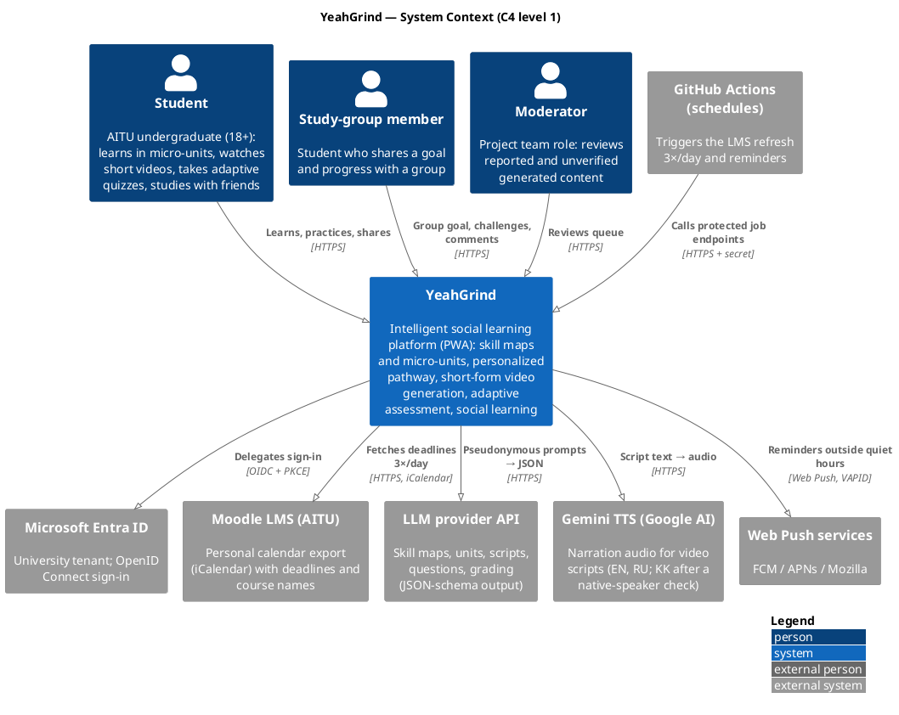
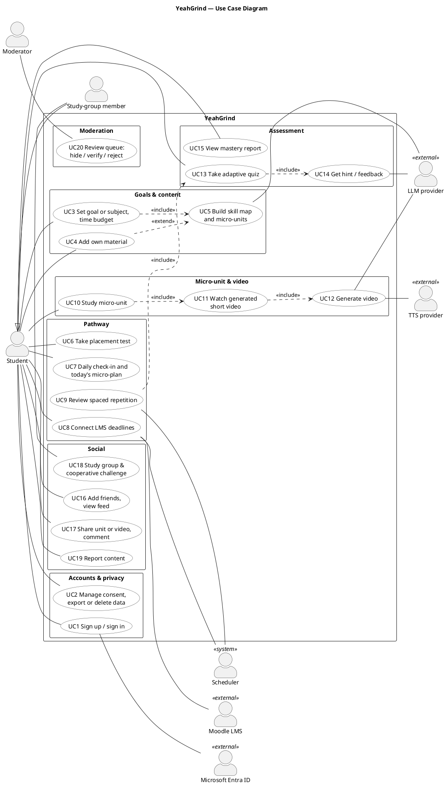
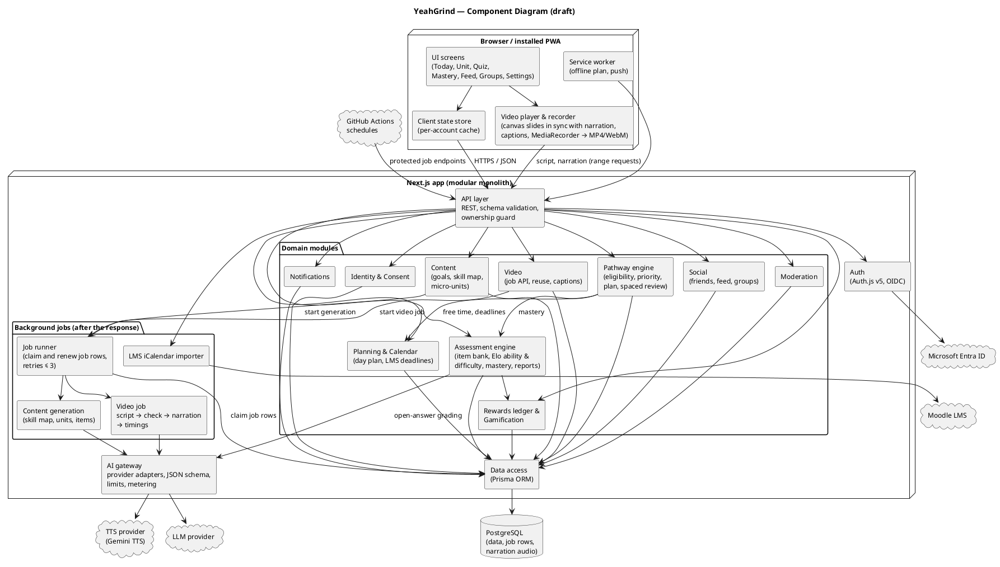
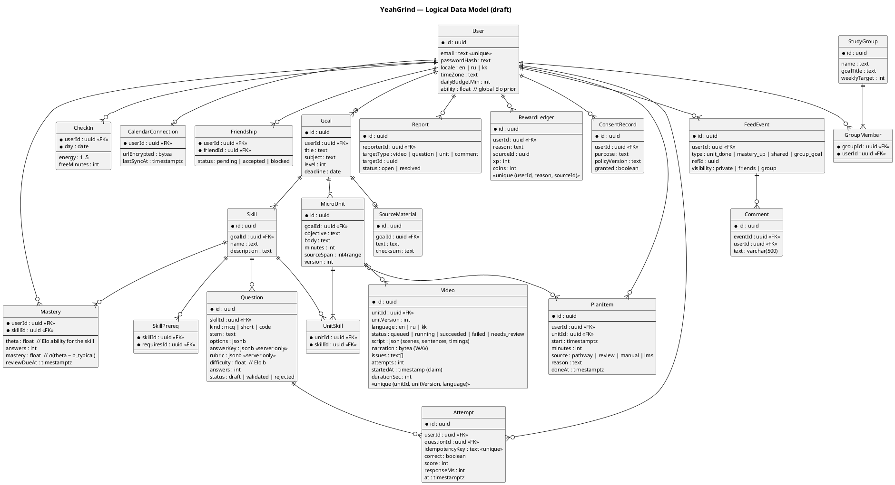
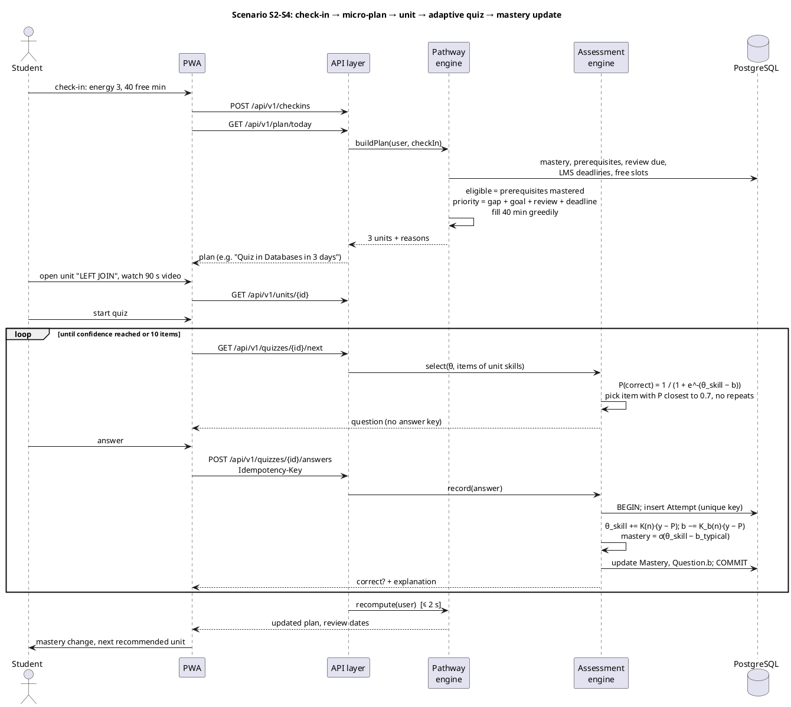
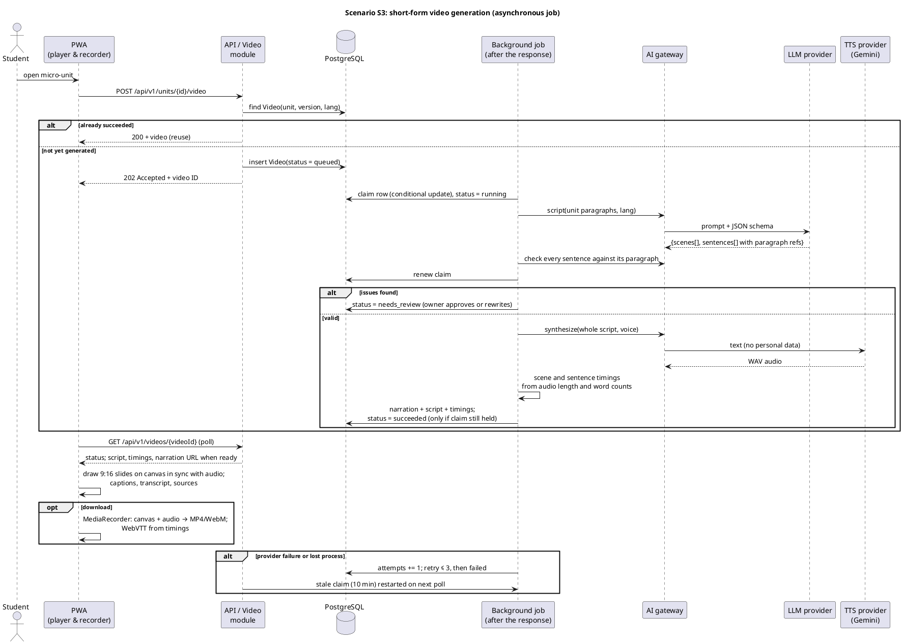
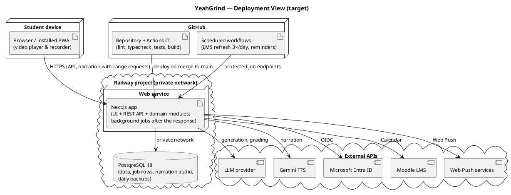

# 7. Architecture and Diagrams

All diagrams are kept as editable PlantUML sources in [`diagrams/src/`](../diagrams/src/) with SVG and PNG exports in [`diagrams/export/`](../diagrams/export/); see [`diagrams/README.md`](../diagrams/README.md) to regenerate them.

| # | Diagram | Purpose |
|---|---|---|
| 1 | [System context](../diagrams/export/01-system-context.svg) | YeahGrind, its users and the external systems it depends on |
| 2 | [Use case](../diagrams/export/02-use-case.svg) | 20 use cases in six areas, mapped to actors |
| 3 | [Component (draft)](../diagrams/export/03-component.svg) | Web app with background jobs, domain modules and adapters |
| 4 | [Logical data model](../diagrams/export/04-data-model.svg) | Entities for content, pathway, assessment, video, social and rewards |
| 5 | [Sequence: pathway and adaptive quiz](../diagrams/export/05-sequence-trajectory-quiz.svg) | Check-in → micro-plan → unit → adaptive quiz → mastery update |
| 6 | [Sequence: video generation](../diagrams/export/06-sequence-video-generation.svg) | Asynchronous job with validation, narration, client-side rendering and reuse |
| 7 | [Deployment](../diagrams/export/07-deployment.svg) | Web service, database, AI services, scheduled workflows, CI/CD |

## 7.1 Architectural style

YeahGrind is a **modular monolith built from one TypeScript codebase**:

- a **web process** (Next.js) serves the PWA and the REST API and runs background jobs (content generation, video scripts and narration) right after the HTTP response;
- **scheduled work** (LMS refresh three times a day, reminders) is triggered by GitHub Actions workflows that call authenticated endpoints;
- **video frames are rendered in the learner's browser**, so no CPU-heavy work runs on the server.

Domain modules own their tables and expose functions; other modules call only those functions. A job is the domain row itself, claimed with a conditional update, so no extra infrastructure is needed.

This style fits two developers and a pilot load of up to a few hundred users. It gives ACID transactions for mastery updates and rewards. Module boundaries allow jobs to move to a worker with a queue (pg-boss) later, when server-side rendering or more job types appear. Alternatives and scores: [05-technology-comparison.md](05-technology-comparison.md) and the ADRs in [`docs/adr/`](adr/).

## 7.2 System context

YeahGrind serves three human roles and depends on six external systems:

- **Microsoft Entra ID:** used only for sign-in, through the authorization code flow with PKCE; only the university tenant is allowed.
- **Moodle:** read only through the student's own iCalendar export.
- **LLM and TTS providers:** receive unit text and answers without personal identifiers.
- **Object storage:** holds generated media, which the browser downloads through signed, expiring URLs.

## 7.3 Use cases

| Use cases | Requirements | Components | Prototype screen |
|---|---|---|---|
| UC1–UC2 accounts, consent, data rights | FR-01 – FR-04 | Auth, Identity & Consent | P9 |
| UC3–UC5 goal, material, skill map, micro-units | FR-05 – FR-09 | Content, Content generation | P1 |
| UC6–UC9 placement, check-in and micro-plan, LMS, review | FR-10 – FR-18 | Pathway engine, Assessment engine, Planning, LMS importer | P2, P3 |
| UC10–UC12 micro-unit and video | FR-19 – FR-24 | Video, Video pipeline, AI gateway | P4 |
| UC13–UC15 adaptive quiz, hints, feedback, mastery report | FR-25 – FR-30 | Assessment engine, AI gateway | P5, P6 |
| UC16–UC19 friends, feed, sharing, groups, reports | FR-31 – FR-35 | Social, Moderation | P7, P8 |
| UC20 moderation queue | FR-36 | Moderation | P10 |

## 7.4 Components

| Component | Responsibility | Key design decisions | Requirements |
|---|---|---|---|
| UI screens (PWA) | Today plan, unit + video, quiz, mastery, feed, groups, settings | Mobile-first (320 px); loading and error states for every request; captions on by default | FR-12 – FR-40, NFR-08 – NFR-10 |
| Service worker | Offline view of today's plan, push reception | Network-first for API, cache-first for static assets | NFR-10, FR-39 |
| API layer | REST handlers, validation, error mapping, ownership guard | Zod schemas shared with the client; Problem JSON errors; `Idempotency-Key` on state-changing learning endpoints | NFR-05, NFR-07 |
| Auth | E-mail + password and Microsoft Entra ID | Tenant restriction; HttpOnly, Secure cookies | FR-01, FR-02 |
| Identity & Consent | Profile, consent records, export, deletion | Versioned consent; cascade deletion | FR-03, FR-04 |
| Content | Goals, source material, skill map, micro-units | Units versioned; source spans kept for grounding | FR-05 – FR-09 |
| Content generation (background job) | LLM-assisted skill extraction, segmentation and question drafting | JSON-schema outputs; acyclicity and length checks; drafts must pass validation before use | FR-08, FR-09, FR-25 |
| Pathway engine | Eligibility, priority, daily micro-plan, spaced review, explanations | Deterministic; weights in configuration (§7.6) | FR-10 – FR-15 |
| Assessment engine | Item bank, adaptive selection, ability/difficulty and mastery updates, reports | Elo-style ability per skill and item difficulty (§7.7) | FR-25 – FR-30 |
| Video module + player | Job API, status, reuse; script → validation → narration → timings and captions; frames drawn and recorded in the browser | The video row is the job: unique (unit, version, language), conditional-update claim renewed between steps, at most 3 attempts; `needs_review` state (§7.8) | FR-19 – FR-24, NFR-03 |
| AI gateway | LLM and TTS adapters, prompt templates, schema validation, limits, cost metering | Provider-neutral interface; no personal identifiers; storage disabled | NFR-06, NFR-11, NFR-13 |
| Social | Friends, feed, sharing, comments, study groups | Visibility per item (private / friends / group); cooperative group goal | FR-31 – FR-34 |
| Moderation | Reports, review queue, audit log | Rejected generated items are never served | FR-35, FR-36 |
| Planning & Calendar, LMS importer | Day plan, calendar, LMS deadlines, timetable import | iCalendar URL encrypted (AES-256-GCM); refresh 3×/day by a scheduled GitHub Actions workflow calling an authenticated endpoint | FR-16 – FR-18 |
| Rewards ledger | XP, levels, stats, coins, skins | Append-only ledger with unique (user, reason, source) | FR-37, FR-38 |
| Notifications | Reminders for planned units and due reviews | Quiet hours per device, time-zone aware | FR-39 |
| Data access | Prisma ORM over PostgreSQL | Migrations in Git; transactions for mastery and ledger | NFR-07, NFR-12 |

## 7.5 Data

- **Content:**
  - `Goal`;
  - `SourceMaterial`;
  - `Skill` with `SkillPrereq` (a directed acyclic graph);
  - `MicroUnit`, versioned, with `UnitSkill` mapping.
- **Video:** one row per *(unit, unit version, language)*. The row holds status, the validated script with scene timings, the issues found by the check, the attempt counter and the narration audio (WAV); captions are computed from the timings. The unique constraint makes reuse automatic (FR-22).
- **Assessment:**
  - `Question` with its difficulty *b*; the answer key and rubric are server-only;
  - `Attempt`, append-only with a unique idempotency key;
  - `Mastery`, holding the Elo ability *θ*, the answer count, the mastery estimate and the next review date per user and skill;
  - the learner ability *θ*, stored on `User`.
- **Pathway and planning:**
  - `CheckIn`, one per day;
  - `PlanItem`, which records the source and the generated reason;
  - `CalendarConnection`.
- **Social:** `Friendship` (pending, accepted or blocked), `FeedEvent` with visibility, `Comment`, `StudyGroup`, `GroupMember`, `Report`.
- **Economy and privacy:** `RewardLedger` and `ConsentRecord`.

All user-owned rows reference `User` with `ON DELETE CASCADE`, so account deletion is a single verifiable operation (FR-04).

## 7.6 Personalized microlearning pathway

1. **Eligibility.** A unit is eligible when every prerequisite skill has mastery `≥ 0.85` (placement results count). Units already mastered are excluded unless a review is due.
2. **Priority.** For each eligible unit *u*:

   `priority(u) = 0.35·gap + 0.25·goalRelevance + 0.20·reviewDue + 0.20·deadlineProximity`

   - *gap* = 1 − mean mastery of the unit's skills;
   - *goalRelevance* = the unit's weight on the path to the goal;
   - *reviewDue* = 1 when the review date has passed;
   - *deadlineProximity* rises as a related LMS deadline approaches (1 at ≤ 1 day, 0 beyond 14 days).
3. **Fitting the day.** The daily check-in gives free minutes and energy. Units are added greedily by priority while their total time stays within the free minutes. With low energy (1–2), review and shorter units are preferred. Each unit is placed into the first free slot of the day plan.
4. **Explanation.** The factor with the largest contribution selects a reason template, e.g. *"Quiz in Databases in 3 days"*, *"Review due: LEFT JOIN"* or *"Next step after GROUP BY"*. The full breakdown is available on demand (FR-13).
5. **Spaced review.** After a skill reaches mastery, its review date is set at 1, 3, 7 and 14 days. A review quiz that drops mastery below the threshold resets the interval (FR-15).
6. **Recomputation** runs after every quiz and check-in, within 2 s (NFR-02).

The weights are initial values and are kept in configuration. Benchmark B1 compares the pathway against non-adaptive orderings ([09](09-verification-evaluation-plan.md)).

## 7.7 Adaptive knowledge assessment

The assessment engine uses an **Elo-style rating**: one ability per *(learner, skill)* and one difficulty per item, both updated online after every answer. Pelánek (2016) shows that Elo is closely related to the Rasch (1PL) model, needs no calibration on large samples, and gives nearly the same estimates as joint maximum likelihood. The comparison with IRT-based adaptive testing and Bayesian Knowledge Tracing is in [05 D13](05-technology-comparison.md#d13-adaptive-knowledge-assessment-model) and [ADR-0007](adr/0007-adaptive-assessment-model.md).

- **Success probability:** `P(correct) = 1 / (1 + e^-(θ_us − b_i))`.
  - *θ_us* is the ability of learner *u* in skill *s*. It starts from the learner's global prior *θ_u*, which comes from the placement test and other skills.
  - *b_i* is the difficulty of item *i*. A new item starts from the difficulty level estimated at generation time (easy / medium / hard → −1 / 0 / +1).
- **Selection:** among validated items of the current unit's skills that have not been seen in this quiz, pick the one with *P* closest to **0.7**. A small random tie-break avoids always serving the same item.
- **Update** after an answer with outcome *y*:
  - *y* is 0 or 1 for closed questions, or the graded score *s/100* for open answers;
  - `θ_us ← θ_us + K(n_us)·(y − P)` and `b_i ← b_i − K(n_i)·(y − P)`;
  - the global prior *θ_u* moves with a smaller step;
  - the uncertainty function `K(n) = α / (1 + β·n)` (α = 0.8, β = 0.05) makes early answers count more and stabilises estimates as answers accumulate.
- **Mastery estimate:** `mastery_us = σ(θ_us − b̃_s)`, the predicted probability of solving a *typical* item of the skill, where *b̃_s* is the median difficulty of its validated items. A skill counts as mastered at ≥ 0.85 with at least 3 answers.
- **Stopping rule:** the quiz stops when every targeted skill is classified, either mastered (≥ 0.85) or clearly not yet (≤ 0.30), with at least 3 answers each, or after 10 items.
- **Open answers:** the AI gateway grades them against the hidden rubric. A score ≥ 80 counts as correct for the models. The student sees one strength and one concrete improvement, never a full solution (FR-28, FR-29).
- **Offline validation:** before the pilot, the Elo model is evaluated on a public dataset by next-answer prediction (AUC, RMSE). It is compared with a non-adaptive baseline and with BKT and 1PL IRT fitted offline (benchmark B2 in [09](09-verification-evaluation-plan.md)). Consented answer logs allow re-running this comparison on YeahGrind data later.

## 7.8 Short-form video generation pipeline

| Step | What happens | Checks / failure handling |
|---|---|---|
| 1. Request | `POST /api/v1/units/{id}/video` → existing video returned (reuse) or job created → `202`; work starts right after the response | Unique *(unit, version, language)*; per-user and global daily limits |
| 2. Script | The LLM writes 120–280 words in 4–8 scenes; every spoken sentence carries the number of the unit paragraph it comes from | JSON schema; word count; paragraph references in range |
| 3. Validation | A second model pass checks every sentence against its paragraph | Any issue: `needs_review`; not narrated or published until the goal owner approves or rewrites it (FR-21) |
| 4. Narration | Gemini TTS reads the whole script in one request, in the unit's language and a calm teaching style; scene and sentence timings follow from the audio length and word counts; every video is labeled "AI-generated voice" | Fallback across TTS models with separate quotas; Kazakh enabled only after the native-speaker check |
| 5. Playback | The browser draws 9:16 slides (title, points, term, example, recap) on a canvas in sync with the audio; captions on by default, searchable transcript, sources panel | System fonts cover Kazakh Cyrillic; WCAG contrast; keyboard control |
| 6. Download | On request, the same frames and the narration are recorded with MediaRecorder into an MP4 or WebM file; the WebVTT file is generated from the timings | Container chosen by `isTypeSupported()`; recording takes the video's length |
| 7. Publish and recovery | Status `succeeded`; the narration is served to goal members with range support | A job whose claim is not renewed for 10 minutes (for example, after a redeploy) is restarted by the next status request; up to 3 attempts, then `failed` with a message |

AI calls and tokens are metered per feature and day, and job time is recorded on the video row (NFR-03, NFR-13).

## 7.9 AI gateway and content safety

| Concern | Design |
|---|---|
| Provider independence | `LlmProvider` and `TtsProvider` interfaces; primary and fallback adapters selected in configuration ([ADR-0004](adr/0004-llm-provider-adapter.md)) |
| Output correctness | Every call declares a JSON schema; invalid output is retried once, then reported |
| Prompt injection | Student material, answers and OCR text are wrapped as quoted data; an injection test set runs in CI |
| Pedagogical guardrails | Hints before answers; feedback names a strength and one improvement; the answer is never revealed before an attempt |
| Human oversight | Generated questions start as `draft`; scripts and items that fail checks, or that students report, go to the moderation queue |
| Privacy | No names, e-mails or account IDs in prompts; provider storage disabled where possible; images are not stored |
| Limits and cost | Per-user limits for generations, videos and gradings, a global daily cap, metering of tokens and TTS characters |

## 7.10 Social learning

- **Visibility:**
  - every feed event has a visibility level (*private*, *friends* or *group*), with *friends* as the default;
  - quiz scores are private unless the owner shares them;
  - blocking removes the blocked user from feeds and search.
- **Cooperative groups:**
  - a study group has a shared goal and a weekly target, the number of units completed together;
  - progress shows the group total;
  - individual ranking is hidden by default, following the evidence on competitive and punitive mechanics ([03](03-literature-review.md)).
- **Sharing:** units and videos can be shared to friends or groups; comments are limited to 500 characters; every item can be reported.

## 7.11 Cross-cutting concerns

| Concern | Measures |
|---|---|
| Security | OWASP ASVS Level 1 baseline; ownership checks on every resource; CSRF protection; rate limits on authentication and generation; secrets only in server environment variables |
| Idempotency and concurrency | Idempotency keys for answers and generation requests; unique constraints for videos and ledger entries; transactions around mastery and reward updates; the job is the domain row itself; job claims by conditional update with a renewable claim token |
| Time zones | Stored as UTC; shown and scheduled in the user's IANA time zone (default Asia/Almaty) |
| Localization | Message catalogs for EN, RU and KK; video narration language per unit request |
| Observability | Structured logs with request ID; job metrics; AI cost metering; error-rate alert |

## 7.12 Deployment

A Railway project holds two services on a private network:
- a web service (Next.js) that also runs background jobs;
- PostgreSQL 18, with daily backups; it also stores the narration audio.

External services: the OpenAI API (text generation and grading) and Gemini TTS (narration). Video frames are rendered in the learner's browser. GitHub Actions runs lint, type checking, tests and a production build on every pull request, and scheduled workflows trigger the LMS refresh three times a day and reminders. A merge to `main` deploys the web service. Pre-defense versions are tagged.

## 7.13 Alignment check

| Check | Result |
|---|---|
| Every functional requirement belongs to a use case | FR-01 – FR-41 are covered by UC1 – UC20 (§7.3); FR-37 – FR-41 are cross-cutting |
| Every use case has a responsible component | §7.3 and §7.4 |
| Every entity is written by exactly one module | Content: Goal, SourceMaterial, Skill, MicroUnit; Video: Video; Assessment: Question, Attempt, Mastery; Pathway/Planning: CheckIn, PlanItem, CalendarConnection; Social: Friendship, FeedEvent, Comment, StudyGroup, GroupMember; Moderation: Report; Rewards: RewardLedger; Identity: User, ConsentRecord |
| Every external system has an adapter and a failure strategy | AI gateway (LLM, TTS), storage client, LMS importer, push sender, auth (NFR-11) |
| Key scenarios are shown end to end | Sequence diagrams 5 and 6; prototype scenarios S1–S6 in [08](08-ux-prototype.md) |
